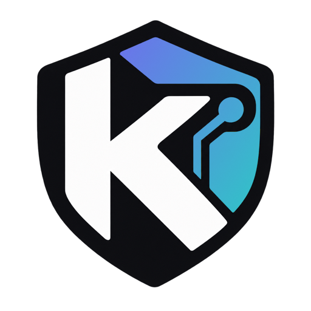
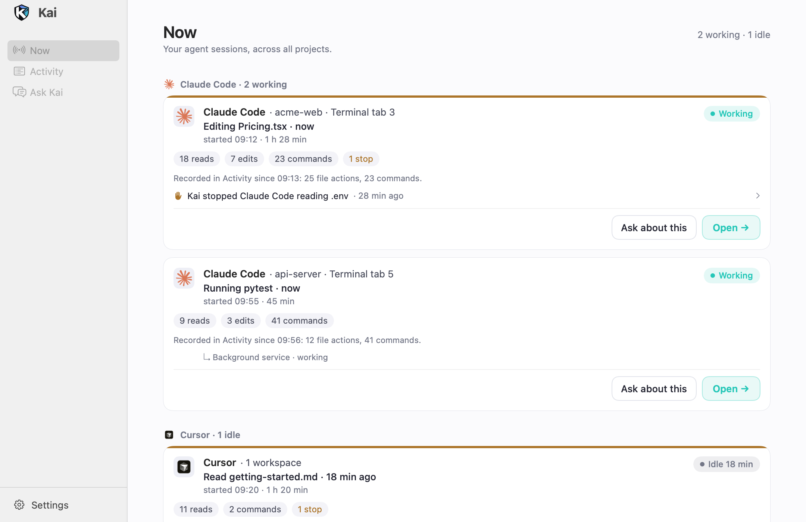
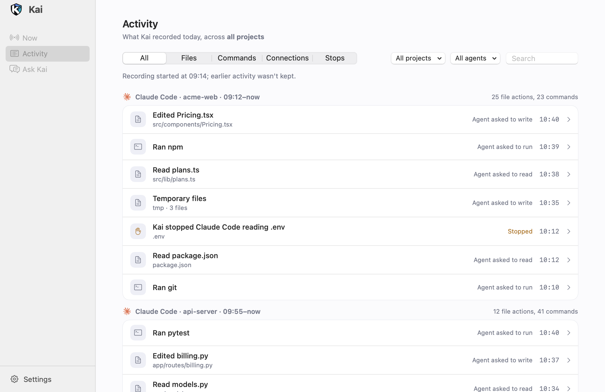
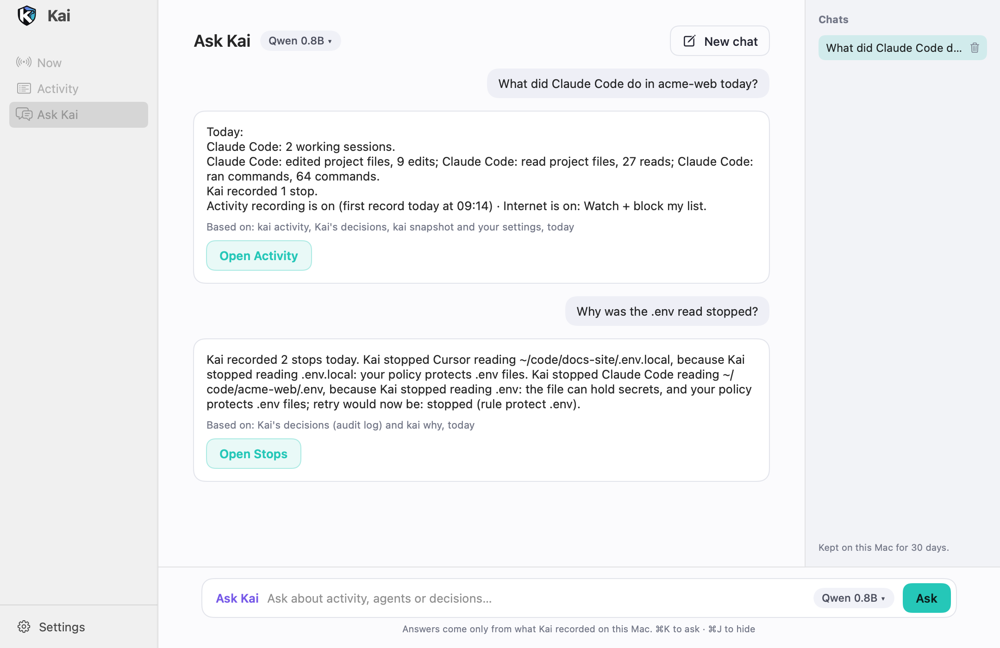
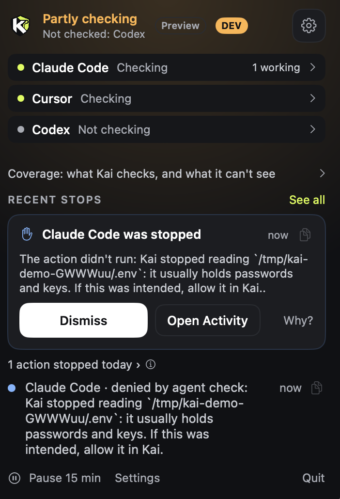
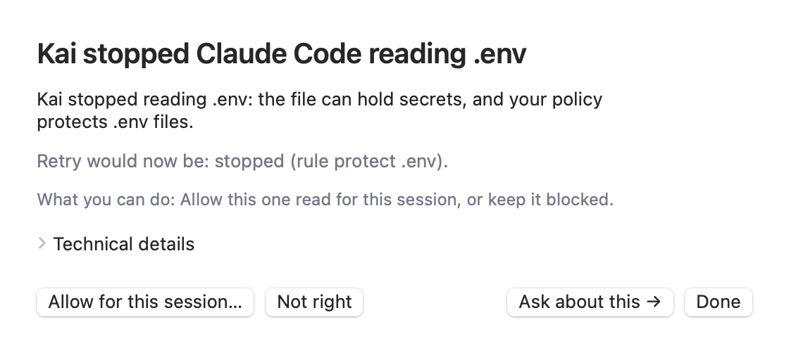

<!-- SPDX-License-Identifier: GPL-3.0-only OR LicenseRef-Kai-Commercial -->

<div align="center">
  

  # Kai

  ### Let your AI agents work. Stay in control.

  **See what your coding agents are doing. Stop risky tool calls. Keep your workflow.**

  **Designed for Zero Trust · Zero Wrappers · Zero Friction**  
  *Built for freedom.*

  **0.5.1-preview.1 · macOS 13+ · Claude Code · Codex · Cursor · Open source**
</div>

Kai is a **local guardrail for AI coding agents**. It connects through supported agent hooks, shows recorded actions by agent and project, explains stops, and lets you ask questions about the evidence — without requiring a special command to launch your agents.

<p align="center">
  <picture>
    <source media="(prefers-color-scheme: dark)" srcset="assets/screenshots/now-dark.png" />
    
  </picture>
</p>

<p align="center">
  <picture>
    <source media="(prefers-color-scheme: dark)" srcset="assets/screenshots/activity-dark.png" />
    
  </picture>
  <picture>
    <source media="(prefers-color-scheme: dark)" srcset="assets/screenshots/ask-dark.png" />
    
  </picture>
</p>

> **Security boundary:** Kai is **not a sandbox**. It can stop supported tool calls *when they pass through an agent's hooks*. It does not control every action a process can take, including a script the agent writes and runs. Internet mode in **0.5.1-preview.1** is off by default: **Watch** records where agents connect, and **Watch + block my list** refuses agents' direct connections to sites you choose. It is not a firewall: an agent could reach a site another way, for example through a proxy. See [coverage](docs/COVERAGE.md) and [known escapes](docs/ESCAPES.md).

## Why Kai

| Principle | What it means in this preview |
|---|---|
| **Zero Trust — by design** | Check sensitive actions at supported tool boundaries; grant exceptions narrowly by agent, operation, target and expiry. **Not** complete zero-trust enforcement across your Mac. |
| **Zero Wrappers — in your workflow** | Keep launching supported agents normally. Kai integrates using their hooks, rather than requiring `kai run` or a separate agent runtime. Initial hook setup and some approvals are required. |
| **Zero Friction — as a goal** | Leave routine development to your agents' ordinary approvals, with focused intervention for risky actions. False stops and setup friction are still possible; [report them](https://github.com/sameehj/kai/issues). |

### What you can do

- **Know what's happening.** See detected agent sessions and recorded activity, grouped by project and session. What Kai cannot observe is marked as a coverage limit.
- **Understand each stop.** Get a reason and decision ID, review it in the app, and make a narrow time-limited exception when appropriate.
- **Ask Kai.** Ask what Kai recorded or stopped; answers cite local records and do not treat missing records as proof that nothing happened.
- **Stay local.** Records live on your Mac. An optional local model helps phrase answers; it does not decide what to block. Downloading the model requires your consent.

## Try it

1. Download the latest preview installer from [GitHub Releases](https://github.com/sameehj/kai/releases), install it, and open Kai from Applications.
2. Open Kai: it connects the agents it finds. Turn any off in Settings → Agents. Alternatively, from Terminal:

   ```sh
   kai install all       # or: kai install claude / codex / cursor
   kai doctor            # inspect actual hook and trust status
   ```

3. For **Codex**, open Codex, run `/hooks`, and trust Kai's hooks. You can then verify with `kai demo` or use `kai demo --live` for an actual agent-run test (uses model quota).

**Internet (preview) is optional and off by default.** Turning it on requires macOS Network Extension approval. **Watch** records where agents connect; **Watch + block my list** also refuses agents' direct connections to the sites on your list. It is not a firewall: an agent could reach a site another way, for example through a proxy. Full [installation and verification instructions](#install) are below.

## New in 0.5

- **Now:** detected agent sessions, with their projects, recent recorded actions and stops. Visibility varies by agent and operation.
- **Activity:** a timeline of recorded actions, grouped by session and filterable by type, project, agent or session.
- **Agent icons** and **a model selector in Ask Kai**: pick Templates, Qwen 0.8B (downloaded only after you agree) or Apple Intelligence right in the chat.

## What changed in 0.4

- **One Kai window:** what Kai recorded today, with the evidence behind each row, and Ask Kai.
- **Ask Kai** answers from Kai's records only, such as "What did Kai stop?" or "Is Cursor connected?". Each answer says what it's based on, and "No matching record" never means it didn't happen. A model, if you pick one, only rewords the answer.
- **Activity recording** (on by default since 0.4.1; turn it off in Settings → General): which files agents read or changed and which commands they asked to run. Kai records metadata only, kept for 7 days.

## What Kai does in this release

- **Supported agent tool calls are checked before execution.** Kai applies fixed rules to the file, shell, prompt, fetch and MCP operations that supported hooks actually report. Some attempts to read sensitive files, expose known secrets, alter hook settings or send sensitive data are stopped with a reason and decision ID (`kai why <id>`). **This is not a guarantee against all ways of accessing or leaking data.**
- **Kai aims not to interrupt ordinary work.** Routine MCP tools, Git, `gh`, builds and tests generally remain under the agent's own approvals; Kai applies its supported checks to high-risk operations, including some destructive MCP actions and cross-host sends. False positives remain possible.
- **Missing Kai fails open.** If its program is missing, the agent continues working without Kai's checks. Kai reports that checks are off when it can detect the problem and offers repair in the app. **Fail-open behavior prioritizes continuity over guaranteed enforcement.**
- **Internet (preview), off by default.** Watch records where agents connect. **Watch + block my list** refuses agents' direct connections to sites you choose. It is not a firewall: an agent could reach a site another way, for example through a proxy.

| | Checked by Kai | Observed only | Not covered |
|---|---|---|---|
| Claude Code | file tools, shell commands, prompts, MCP and web-fetch calls | | scripts it writes and runs, subprocesses' own file access |
| Codex | shell commands, prompts, MCP calls | | the same |
| Cursor | shell commands, file reads, prompts, MCP arguments (secrets only) | | file writes, editor extensions |
| Network (if switched on) | connections from agent processes to sites on your block list | all other agent connections | encrypted contents, other routes to a blocked site |

Details per agent and operation: [docs/COVERAGE.md](docs/COVERAGE.md). What still gets through: [docs/ESCAPES.md](docs/ESCAPES.md).

## The menu-bar app

Kai lives in the menu bar. Click it for its health, today's numbers, your sessions and the latest stop. The full app adds the Now, Activity and Ask views.

<p align="center">
  <picture>
    <source media="(prefers-color-scheme: dark)" srcset="assets/screenshots/popover-dark.png" />
    
  </picture>
</p>

- **Health line:** "Connected · hooks OK" when the agents' hooks answer; "Checking hooks…" only while a check runs; "Claude Code's hooks need repair" (amber) with **Repair**. None of these implies OS-wide protection.
- **Today's numbers:** actions recorded, stops and (while Internet is on) connections.
- **Session rows:** each live session's last action, how long ago, its main count and its stops.
- **Latest stop:** "Kai stopped Claude Code's command · 1h". It opens the decision: what was stopped and why, **Retry would now be** (what Kai would decide if the agent tried again now), the narrow way to allow it, and **Not right** to mark a stop you think was wrong, so it's counted for the study.
  <p align="center">
    <picture>
      <source media="(prefers-color-scheme: dark)" srcset="assets/screenshots/stop-detail-dark.png" />
      
    </picture>
  </p>
- **Open Kai, Ask, Pause:** open the window, ask a question, or pause Kai's checks for 15 minutes or an hour (they resume by themselves).
- **Repair:** if an agent's hooks need repair, or Kai's program is missing, one click puts back Kai's program and hook launcher. It may ask for your password once.
- **Settings → Uninstall:** the only way to remove Kai (see [Uninstall](#uninstall)).

What each agent reports, and what Kai checks: [docs/COVERAGE.md](docs/COVERAGE.md).

The same from Terminal: `kai why <id>` explains a decision, `kai not-right <id>` marks it as wrong, and `kai stats --export` writes the study summary (counts only, no prompts, paths, commands or code) for you to review and send.

## Privacy and safety

**Ask Kai and the local model.** Ask Kai's answers are built from Kai's own records by fixed code. A model is optional and only rewords that answer, or picks which kind of question you asked from a fixed list. It can't make decisions, approve anything, change settings or add buttons. The local model (Qwen3.5 0.8B, about 500 MB) downloads only after you agree, from a pinned version, and Kai checks its SHA-256 before use. It runs on your Mac with no network access. It sees your question and Kai's short answer, never file contents or full commands. Nothing it reads or writes is logged. If the model fails or changes a number, Kai shows its own answer instead. Coverage limits are always shown by Kai, not by the model. Delete the model any time from the model menu in Ask Kai.

*Current limit:* the model runs inside the Kai app process. A future version may move it into a separate sandboxed helper.

## What it doesn't do in this release

- Kai does not prevent other programs from reading files or sending data over HTTPS in this release. That includes scripts the agent writes and runs.
- Malicious changes to SSH configuration, keys or login items outside the checked hook operations.
- Untagged editors such as VS Code.
- Exfiltration through allowed services like GitHub or npm (`npm publish` included).
- Encrypted request contents: not inspected.

**OS-level Files protection: not included in this release.**

How this release was verified: see the [release notes](https://github.com/sameehj/kai/releases). What each agent reports to Kai, and what Kai can stop: [docs/COVERAGE.md](docs/COVERAGE.md).

## Install

**macOS 13 or later; Linux and Windows aren't supported.** Works with Claude Code, Codex and Cursor.

1. **Download** `Kai-Preview-<version>.pkg` from the newest release on the [Releases page](https://github.com/sameehj/kai/releases), and double-click it. It installs the Kai app and the `kai` command.
2. **Open Kai** (Applications → Kai). It lives in the menu bar. Open Kai: it connects the agents it finds. Turn any off in Settings → Agents. Optional: in Settings → Internet, choose **Watch** (records where agents connect) or **Watch + block my list** (also refuses agents' direct connections to the sites on your list; not a firewall).
3. **If you switched Internet on, approve Kai's network extension** when macOS asks. This is what lets Kai see where your agents connect.
   - macOS 13–14: System Settings → Privacy & Security, then click Allow next to Kai.
   - macOS 15: System Settings → General → Login Items & Extensions → Network Extensions, then turn Kai on.
4. **Alternatively, add Kai's checks from Terminal** (the app already did this for the agents it found):
   ```sh
   kai install claude      # and/or: kai install codex, kai install cursor (or: kai install all)
   kai doctor              # each agent should show a ✓
   ```
   Codex runs hooks only after you trust them: open Codex, run `/hooks`, and trust Kai's.

`kai status` shows what's checked, per agent, at any time.

### Verify the download (optional)

Download `Kai-Preview-<version>.pkg.sha256` from the same release into the same folder, then:

```sh
shasum -a 256 -c Kai-Preview-<version>.pkg.sha256            # "Kai-Preview-<version>.pkg: OK"
spctl --assess --type install -vv Kai-Preview-<version>.pkg  # "source=Notarized Developer ID"
```

### When Kai stops something

The message says what Kai stopped, why, and the narrow way to allow it if it was intended (one agent, one operation, one target, with an expiry); see [Allow and block, narrowly](#allow-and-block-narrowly). The agent is told the same, and to ask you instead of trying another way.

### Uninstall

**Preferred uninstall: Kai → Settings → Uninstall.** It removes your agents' hooks, the Internet filter and Kai's program, checks each step, and lists anything left (sometimes "Restart needed"). Then move Kai.app to the Trash.

If the app is already gone, run `kai uninstall all` in Terminal to remove Kai's hooks from your agents, then reinstall Kai and uninstall from Settings, or [contact us](https://github.com/sameehj/kai/issues).

**Don't delete Kai's files by hand** (for example `sudo rm` of `/usr/local/bin/kai` or the hook launcher). That leaves your agents' hooks behind: they keep working, but nothing is checked, and each call shows "Kai is missing: its checks are off".

All releases: [github.com/sameehj/kai/releases](https://github.com/sameehj/kai/releases). From source: `make && sudo make install` (C compiler and `make`).

## See it work

```sh
kai demo          # each installed agent's real hook, on a temporary fake secret
kai demo --live   # a real agent session reads the fake secret, and Kai's log confirms the stop
                  # (uses the agent and its model quota)
```

`kai demo` shows the hook works when called. `kai demo --live` also shows the agent calls it, and sets *Live verification* in `kai status`.

## Allow and block, narrowly

Run these in your own terminal, not through an agent tool. Hook policy may reject agent-originated attempts, but this is not an OS-enforced prohibition.

```sh
kai allow-file ./.env --read --agent claude --for 1h      # the file tool may read this exact file
kai allow-fetch docs.example.org --agent claude --for 1h  # the agent's fetch tool may use this host
kai allow-mcp notion search --agent claude --for 1h       # one MCP tool (or every tool of a server)
kai allow-upload ./report.pdf --to files.example.com --agent claude --for 1h
kai allow-capture --app Safari --agent claude --for 15m   # screen and app control, one app
kai block paste.example.org                               # stop commands and fetches that reach it,
                                                          # and (in Watch + block my list) connections to it
kai rules                                                 # what each agent may do, and why
kai undo                                                  # take back the last change
```

Grants are intended to be scoped to one agent, operation, target and expiry within the supported hook policy. A file grant follows that exact file: if it's replaced or re-linked, the grant stops applying. A read grant doesn't allow writing or uploading the file. `allow-fetch` governs only the agent's fetch tool, never other connections to that host.

## What's checked

Exactly what each agent reports to Kai, at which stage, whether Kai can stop it, the known bypasses, and the evidence (live or synthetic): **[docs/COVERAGE.md](docs/COVERAGE.md)**. `kai status` shows the same per agent: Installed, Configured, Trusted, Self-test and Live verification.

## Known limits

- Hooks run with your permissions. A program an agent writes and runs, or a detached process, can get around them.
- Kai checks only what an agent reports to its hooks: not tool results, not the agent's other model traffic.
- Kai's rules and policy are files a program with your permissions can edit. Kai notices some policy changes made outside Kai (`kai doctor`), never all, and prevents none.
- Files protection: not included in this release. The Internet wall records connections; in **Watch + block my list** it refuses agents' direct connections to the sites on your list. It is not a firewall: an agent could reach a site another way, for example through a proxy or a site that isn't on your list.
- No browser coverage: Kai doesn't check AI chat sites in a browser (the Chrome extension was removed). `kai uninstall chrome` removes one an earlier Kai installed.
- Screen and app control: Kai stops the commands and tools it recognizes (`screencapture`, `ffmpeg`/`sox` recording, `osascript` telling any app, computer-use tools) and names the app; you allow them per app. With the Kai app, those allows are made in the app (each agent's page), not with `kai allow-capture`. A program the agent writes can call the capture APIs directly. Kai can't change macOS privacy prompts: macOS grants these permissions per app, so every agent run in Terminal, iTerm or Cursor inherits what that app holds (`kai doctor` lists them where it can read them).

## What “Triple Zero” does — and does not — promise

**Zero Trust** describes the goal of narrow, explicit authorization at supported boundaries; it is **not** a claim of NIST compliance, universal containment or exfiltration prevention. **Zero Wrappers** means supported agents can use their normal launch flow after integration; it does **not** mean zero installation or approval steps. **Zero Friction** means designing to avoid needless interruptions; it is **not** a zero-false-positive guarantee. These distinctions matter most when a check is missing, bypassed or disabled.

## Design references

Kai is designed with reference to, and does not claim compliance with:

- [NIST SP 800-207](https://csrc.nist.gov/pubs/sp/800/207/final) (Zero Trust Architecture): explicit, per-request decisions and least privilege;
- the [Model Context Protocol specification](https://modelcontextprotocol.io/specification): MCP tool calls are named and checked per server and tool;
- the [OWASP Top 10 for LLM Applications](https://genai.owasp.org/llm-top-10/): sensitive information disclosure, excessive agency, prompt injection;
- [RFC 9325](https://www.rfc-editor.org/rfc/rfc9325) (TLS recommendations) and [RFC 9525](https://www.rfc-editor.org/rfc/rfc9525) (service identity in TLS): how the app's Internet protection names the site a connection is for.

## Roadmap

- **Next: Files protection.** OS-level protection for files, closing the gap left by scripts an agent writes, is not included in this release (in private testing).
- **With the app: capture inside agent process trees.** Blocking screen, microphone and camera capture tools started inside an agent's process tree through Endpoint Security, and a notice when an agent host app's privacy permissions change, where macOS provides the event on the target version.
- Later: team policy, Linux, and Windows.

Roadmap items are plans, not delivered guarantees. The historical overview (pre-v0.2, including since-removed features): [docs/OVERVIEW.md](docs/OVERVIEW.md).

## Contribute

Contributions are welcome: detectors, integrations, documentation and adversarial test cases. See [`CONTRIBUTING.md`](CONTRIBUTING.md). Contributors sign a CLA to support the open-source and commercial licensing options.

## License and security

Kai is offered under **GPL-3.0-only** or a separate commercial license. See [`LICENSE`](LICENSE) and [`COMMERCIAL.md`](COMMERCIAL.md). “Kai” and its logo are trademarks; see [`TRADEMARKS.md`](TRADEMARKS.md).

Found a vulnerability? Please use the disclosure process in [`SECURITY.md`](SECURITY.md), not a public issue.