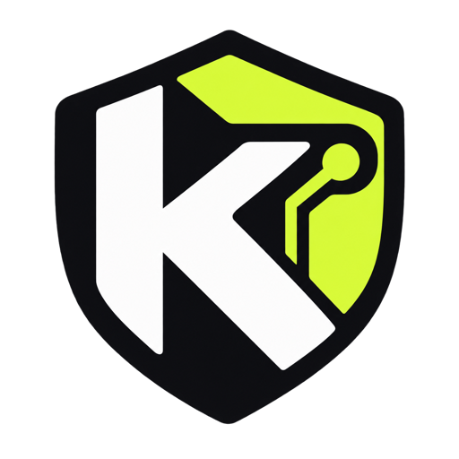

<!-- SPDX-License-Identifier: GPL-3.0-only OR LicenseRef-Kai-Commercial -->

<div align="center">
  

  # Kai

  ### Give AI more work, not more access.

  Kai Preview watches what Claude Code, Codex and Cursor do and can stop risky actions inside those agents: reading your secrets, sending them out, or pasting them into AI chats.

  [Get started](#-get-started) · [How it works](#-how-kai-works) · [Security boundaries](#-what-kai-doesnt-promise) · [Roadmap](#-roadmap)

  **macOS + Linux** · **Claude Code + Cursor** · **Codex (preview)** · **Open source**
</div>

> **This preview is a guardrail, not a sandbox.** Its checks run inside each agent, so a program the agent writes and runs can get around them. See [the coverage table](#-what-preview-1-checks-per-agent) for exactly what's checked. OS-level protection for Files and Internet is in private testing and comes in a later release.

---

## How it works, in three steps

1. **Install Kai.** One package; it adds its checks to Claude Code, Codex and Cursor, and to Chrome for AI chats.
2. **Kai watches your agents and stops the risky moves:** reading your keys, sending your code somewhere you never chose, pasting secrets into a chat. Each block says what happened, why it matters, and what you can do.
3. **You decide what they can reach, once.** `kai allow example.org --agent claude --for 1h` in your own terminal (agents can't run it), `kai block`, `kai rules` to see everything, `kai undo` to take it back.

Then hand your agents bigger jobs and stop babysitting them.

```text
$ kai install
Kai is watching Claude Code, Codex and Cursor.
Try it: ask your agent to read ~/.ssh/id_rsa. Kai blocks it and tells you why.
```

**Honest limits.** Kai's checks run *inside* each agent. A program an agent writes and runs can get around them, and without OS protection it could also edit Kai's settings and rules. `kai status` says this too. OS protection for Files and Internet is in private testing.

## 🛡️ Why Kai?

AI coding agents can read files, run commands and connect to the internet using your permissions. Think of a contractor working in your house: you want them fixing the kitchen, not opening your safe. Kai helps you lock the safe without stopping the work.

- 🔒 **Protect sensitive files.** Block agent actions that try to read SSH keys, `.env` files and other protected paths, through the agent's own tools and the shell commands it runs.
- ✋ **Stop recognized risky actions.** Apply local rules to supported file reads, shell commands, prompts and tool calls: redact secrets, block uploads, flag likely prompt injection.
- 👀 **Spot unfamiliar connections (macOS).** See agent connections to destinations outside your trusted list.

Kai runs locally, never stores detected secret values in its audit log (excerpts are redacted first), and needs no Kai account.

**Security status:** agent hooks and local scanning are tested. On a development-signed Mac both OS walls run live: **Files** (the storage wall, Endpoint Security) stops agents opening protected files even from a script they wrote, and **Internet** (the network wall) limits an agent's connections to hosts you allowed, including raw connections to an IP (note: from Oct 23 to Oct 28 a bug let every destination through in Protect; fixed and verified live in network extension v18). Blocks come with a decision card (allow for this session, Touch ID for secrets, or "Always protected"), "Keep blocked" is remembered per agent and host, and you can pause Kai for 15 minutes from the menu bar (per-session pause is still being verified, so it is hidden). Gaps that remain: DNS lookups always go through, processes that leave the agent's process tree aren't attributed, and the Files wall needs Apple's Endpoint Security entitlement before it can ship to other Macs. The end-to-end acceptance run (three concurrent sessions) is still to be recorded. [Security validation](docs/SECURITY-VALIDATION.md) gives a measured verdict for each risk, the [escape suite](docs/ESCAPES.md) lists every attempt, and the rest is in [what Kai doesn't promise](#-what-kai-doesnt-promise).

## ✅ What Preview 1 checks, per agent

Kai Preview is a guardrail inside each agent, not a sandbox. Measured with each agent's real hook format against the real `kai hook` ([full matrix and evidence](docs/COVERAGE.md), regenerated by `make test`):

| Operation | Claude Code 2.1 | Codex 0.162 | Cursor 3.27 |
|---|---|---|---|
| Read a protected file with the agent's file tool | Denied by agent check | n/a (no file tool) | Denied by agent check |
| Read it via a shell command | Denied by agent check | Denied by agent check | Denied by agent check |
| Read it via a script the agent writes and runs | **Not stopped** (known bypass) | **Not stopped** | **Not stopped** |
| Secret in a prompt | Denied by agent check | Denied by agent check | Denied by agent check |
| Upload command (`curl -d @file`) | Denied by agent check | Denied by agent check | Denied by agent check |
| MCP tool call with no rule | Held until you approve | Held until you approve | Arguments scanned for secrets only |

Nothing in this table is *blocked by macOS*: that's OS-level protection (Files, Internet), in private testing.

## ✨ What Kai can do today

| Layer | What it does | Status |
| --- | --- | --- |
| **Agent hooks** | Deny protected file reads and suspicious commands in Claude Code and Cursor; examine supported tool and prompt events | ✅ Working and tested |
| **Codex hooks** | Same checks for OpenAI Codex CLI (shell commands, `apply_patch` edits, MCP arguments, prompts) | 🧪 Blocking verified live with Codex CLI 0.162.1 once its hooks are trusted in `/hooks` |
| **Browser extension** | Check what you paste and send in ChatGPT, Claude.ai, Gemini and other AI chats (Chrome, Brave, Edge) | 🧪 Native host tested; not yet tried on live chat sites |
| **Policy + scanner** | Redact detected credentials, replace company terms, or block confidential markers | ✅ Working and tested |
| **Audit log** | Record decisions in a hash-chained log without storing detected secret values | ✅ Working and tested |
| **macOS menu-bar app** | One status sentence, decision cards, Agent Control (sessions working / idle / ended, permissions, pause), Settings for Files, Internet and Chats | ✅ Running in development; live checks in `scripts/live-checks*.sh` |
| **Local AI gateway** | Inspect and transform requests explicitly routed through it to supported model APIs | 🧪 Tested with a fake upstream; live-agent testing pending |
| **Internet (network wall)** | Use a signed macOS Network Extension to watch or restrict agent connections by destination; a verified heartbeat (with flows seen, agent flows and blocks) drives the status | ⚠️ **Protect did not block from Oct 23 to Oct 28** (an endpoint-permission check allowed every destination); fixed in network extension v18 and **verified live** (an agent's request to example.com blocked, logged and carded; GitHub, npm and the Anthropic API still reachable) · DNS always allowed ([known gaps](docs/SECURITY-VALIDATION.md#network-wall-live-run)) |
| **Files (storage wall)** | Stop agents opening protected files at all (macOS Endpoint Security); agents keep their own working files; decision cards with session permissions and Touch ID | ✅ Enforcing live on development builds (Endpoint Security dev entitlement) · distribution needs Apple's entitlement |

**Important:** Hooks only see actions exposed by supported agent hook integrations. They are not OS-level sandboxing. The gateway protects only traffic routed through it. See [security boundaries](#-what-kai-doesnt-promise).

## 🚀 Get started

### 1. Install Kai

**Build from source** (works now; requires a C compiler and `make`):

```sh
git clone https://github.com/sameehj/kai.git
cd kai
make
sudo make install
```

**Installer script** (review before executing):

```sh
curl -fsSLo kai-install.sh https://raw.githubusercontent.com/sameehj/kai/master/install.sh
less kai-install.sh
sh kai-install.sh
```

The installer is designed to verify release files against `SHA256SUMS` when available and fall back to a source build. A checksum hosted beside its artifact is not an independent authenticity guarantee. Public binary releases and notarized macOS distribution are not confirmed yet.

**Homebrew (source build):**

```sh
brew tap sameehj/kai https://github.com/sameehj/kai
brew install --HEAD kai
```

### 2. Turn on agent protection

```sh
kai init
kai install claude
kai install cursor
kai install codex      # preview; then open Codex and trust Kai's hooks in /hooks
kai doctor
```

**Codex runs only hooks you've trusted**, and a hook whose command changed counts as new. Until you trust Kai's hooks in Codex's `/hooks`, Codex skips them without a warning, and `kai status` can't tell. `sh tests/codex/run_codex_check.sh` checks it live.

These commands write the default policy, integrate Kai into the agents' hook settings, and inspect the resulting setup. Kai preserves prior settings via backups when installing its entries. You can enable just one agent if you prefer.

### 3. See what Kai catches

```sh
kai scan .env                 # inspect a file for secrets and company terms
kai status --json            # what's on, and whether each hook answers a live check
kai log tail                 # inspect recent decisions
kai log verify               # verify the audit hash chain
```

Edit `~/.kai/policy` to define which paths, secrets, and company terms are sensitive to you.

## ⚙️ How Kai works

```text
You → AI coding agent
          │
          ├─ File read       → Kai hook → allow / deny
          ├─ Shell command   → Kai hook → allow / deny
          ├─ MCP/tool event  → Kai hook → inspect / redact / block
          └─ Tool response   → Kai hook → flag suspicious instructions

Optional: supported agent → Kai local gateway → model API
                        (only if explicitly configured)

macOS: agent process (and its children) → Network Extension
          → host on allowlist? allow : log (or drop in Block mode)
```

### Protect sensitive files

Kai can deny supported agent operations that target files such as `~/.ssh`, `~/.aws`, `.env`, or `*.pem`, along with your own protected paths. It can also detect certain risky shell commands, including upload patterns such as `curl -d @file`, `scp`, and `nc`.

Shell commands are read the way a shell would read them: quotes and escapes are resolved, and `$(…)`, backticks, `sh -c`, `eval` and heredocs are looked into. So `cat ~/.ss''h/id_rsa`, a path inside `python3 -c` and `k=kai; $k uninstall` are caught, while a commit message that merely mentions those words is not.

These are still **hook-level checks**: a tripwire, not a sandbox. Anything a program computes at run time (a path built from variables, a script that reads a file itself) is out of their reach. That's what the OS-level walls are for.

#### SSH and git keep working — load your key into the agent

Kai protects **private** keys, not the public bits of `~/.ssh`. An agent may still read `known_hosts`, `known_hosts.old`, `config` and `*.pub` (host verification and public keys), but never a private key file like `id_ed25519` or `id_rsa`.

So `git push`/`git fetch`/`ssh` over SSH work with both walls on **as long as the private key is loaded into ssh-agent** — then ssh authenticates through the agent and never opens the key file:

```sh
ssh-add --apple-use-keychain ~/.ssh/id_ed25519   # once; stores it in the macOS Keychain
ssh-add -l                                        # confirm it's loaded
```

Add `AddKeysToAgent yes` and `UseKeychain yes` to `~/.ssh/config` to load it automatically on first use. The same pattern applies to other secrets Kai protects — let the tool's own keychain/agent hold the secret so no process opens the file: `gh auth login` (GitHub over HTTPS), `aws sso login` (AWS), `gcloud auth login` (Google Cloud), `npm login` (npm), `gpg-agent` with pinentry-mac (GPG), `docker login` with the osxkeychain store (Docker).

Agents also can't switch Kai off from inside: their own hook settings (`~/.claude/settings.json`, `~/.cursor/hooks.json`, `~/.codex/hooks.json` and `config.toml`, project-level copies too) and `~/.kai` are always protected, whatever the policy says.

### Keep company context in your control

Kai's local scanner supports four actions: **redact**, **replace**, **block**, and **warn**. For example, your own policy can replace an internal codename before text is sent through an inspected path.

```text
protect ~/.ssh
protect .env
allow   .env.example

secrets redact
term replace:"Project X" Project Falcon
term block CONFIDENTIAL
term block "Globex Corporation"          # a customer name
rule zendesk_ticket block zendesk[.]com/agent/tickets/[0-9]+
rule internal_host redact [a-z0-9-]+\.corp\.example\.com
```

These apply to prompts, and to **files the agent reads**: before the agent's Read tool, or `cat`, `grep`, `head` and similar commands, Kai checks the file's contents. A file holding one of your `block` terms or rules is always blocked. A file holding a secret Kai detects follows `on_file_secret`: **ask** (default; Claude Code shows its own approval prompt, Cursor asks for shell commands, Codex and Cursor file reads block), `block` or `warn`. `on_upload ask` works the same way for upload-looking commands. "Not a threat" in the app adds an exception for that one file. Data that reaches the model some other way (a script that prints it, a web page) isn't checked by the hooks; the [gateway](#-optional-ai-gateway) checks whole requests.

See [`policy/default.policy`](policy/default.policy) for the complete policy grammar.

### Review what happened

Kai records its decisions (blocks, redactions, warnings; not the many allowed actions) in a hash-chained audit log that never stores the matched secrets. Each record says what it was about: the tool, a short excerpt of the command or path with every detected secret replaced by `[REDACTED by Kai: …]`, and the part that matched. **Prompts are never stored**, not even redacted: a blocked prompt is recorded as "(prompt, N characters - not kept)". The log is readable only by you (mode 600), rotates at its size limit to `audit.log.1` (one old file is kept, so the history is bounded), and `kai log verify` checks the chain. `kai log export <file>` writes your own copy (both files, 600). After a block, Kai also notes what the agent did next (tried a different command, switched tools, or stopped). Redaction is only as good as the detectors, so `kai policy set audit_context off` keeps just the rule and reason.

```sh
kai log show          # recent decisions in words, with what the agent did next
kai report <id>       # a false-positive report: a local file and a GitHub issue link, nothing sent
```

In the menu-bar app, Activity shows the same timeline. **Not a threat** on a blocked command adds a narrow exception (that rule, that exact command; every other check still runs and each use is logged) or allows a file, and can write a report for us. Kai's own protection can't be exempted. Notifications come once per rule, not once per retry.

The log rotates at 8 MB and appending stays fast however long it gets. The chain helps detect some unauthorized changes, but it is **not tamper-proof** against an attacker who controls the log and its verification state.

## 💬 AI chats in your browser

The Kai extension checks what you paste and send on ChatGPT, Claude.ai, Gemini, DeepSeek, Perplexity, Copilot, Mistral, Grok and Poe, using the same local policy as everything else.

- **Pasting** text that contains a secret pastes a cleaned version and tells you what was removed.
- **Sending** a message with something sensitive holds it and offers **Redact and send**, **Send anyway** or **Edit**. If your policy says *block* (for example a `CONFIDENTIAL` marker), only **Edit** is offered.
- Messages with nothing sensitive send as usual. Every choice lands in the audit log; the text itself never does.

The extension talks to `kai` on your Mac through the browser's native messaging, so nothing goes through a proxy and no certificates are involved.

```sh
kai install chrome     # registers Kai with Chrome, Brave, Edge and Chromium
```

Then load the extension once: open `chrome://extensions`, turn on **Developer mode**, click **Load unpacked** and choose the folder the command prints. In the menu-bar app, the Chrome card's **Load the extension to finish** button does the same: it copies the folder path and opens the extensions page.

**Current maturity:** the native host is covered by automated tests. The page integration has a local test page (`integrations/browser/kai-browser-test.html`) and has not yet been tried on the live chat sites, whose editors change often. A Chrome Web Store listing is planned.

## 🧩 Other agents

| How the agent works | What Kai uses | Examples |
| --- | --- | --- |
| Has a hook system | `kai install <agent>`: checks every file read, command, tool call and prompt | Claude Code, Cursor, Codex |
| No hooks | The network wall recognizes it and applies the egress allowlist; the AI gateway cleans its requests if it supports a base URL | Aider, Continue, OpenCode, Goose |
| Runs in the browser | The browser extension | ChatGPT, Claude.ai, Gemini |

Teach Kai to recognize any other agent by its executable, an argument, or its Apple signing team:

```sh
kai policy add agent aider arg '*/bin/aider'
kai policy add agent mytool team ABCDE12345
kai agent-of <pid>            # check what Kai thinks a process is
```

## 🌐 Optional AI gateway

The local gateway can inspect outgoing model API requests from clients configured to use it. It listens on loopback and forwards to configured, fixed provider destinations.

```sh
kai gateway &
ANTHROPIC_BASE_URL=http://127.0.0.1:8787 claude
OPENAI_BASE_URL=http://127.0.0.1:8787/openai/v1 codex
```

**Current maturity:** Tested against a fake upstream, not yet verified end-to-end with real Claude Code. Cursor's built-in model requests are not redirected by this configuration; its supported hooks remain the current integration path.

## 🍎 macOS app and system protection

`Kai.app` is a menu-bar interface for local status, agent switches, notifications, recent events, and policy changes. A development build is running; distribution to other Macs requires the appropriate signing and notarization steps.

The **Network wall** is a signed Network Extension that checks connections made by agent processes (Claude Code, Cursor, Codex and anything they start) against an egress allowlist. Other apps are left alone. Built in: this Mac and the model and sign-in hosts. **GitHub (and other code hosting), package registries and Apple developer services are optional channels, off by default**, because they're broad routes for sending data out or pulling code in. Turn one on per agent in Agent Control (Touch ID), or with a `channel <agent>/<name>` policy line (`code-hosting`, `packages`, `apple-developer`).

**Verified so far (macOS 14, Log mode):** a request from Claude Code to `example.com` was recorded in the audit log; a request to allow-listed `github.com` was not; requests from non-agent apps were not inspected. It also surfaced Claude Code's own telemetry connection, which is the kind of visibility Log mode is for.

**Verified so far (macOS 14, Block mode):** Claude Code's connections to hosts that aren't allowed were dropped and logged, over HTTPS, plain HTTP, another port named by hostname, HTTPS straight to an IP, a Python POST, and a backgrounded child; `github.com` (allowed) went through. `python3 tests/network/run_network_check.py` re-runs this from inside your agent; results are in [security validation](docs/SECURITY-VALIDATION.md#network-wall-live-run).

- **Destinations are matched by hostname** for web traffic on ports 80 and 443 (TLS server name or HTTP `Host`), and by the flow's hostname on other ports. Allow addresses too: `egress_allow 10.0.0.0/8`, `egress_allow 203.0.113.5:22`, `egress_allow db.example.com:5432`; your own Mac (loopback) is always allowed.
- **Connections with no hostname** on other ports (a raw socket to an IP, SSH to an IP, a database) are dropped in Block mode unless an address entry allows them, and logged in Log mode (verified live on macOS 14).
- **Gaps in Block mode today:** DNS lookups always go out; a process handed to `launchd`, or one whose parent shell has exited, is no longer treated as the agent's and isn't filtered; if the wall can't read the policy it allows everything. Don't rely on Block mode as complete egress containment yet.
- **Turning it on** takes one approval in System Settings → Privacy & Security, plus the "filter network content" prompt.

```sh
make try-app KAI_TEAM=<your Apple team ID>   # build signed, install to /Applications, open
systemextensionsctl list                     # expect: io.github.sameehj.kai.network … [activated enabled]
kai log tail                                 # network entries have "source":"network"
```

Building the extension needs a paid Apple Developer account. A development build only runs on Macs registered to that account.

The **Storage wall** stops agents from opening protected files at all, not just through their tools. Its decision engine is built and tested; enforcement needs Apple's Endpoint Security entitlement, so it ships off (`storage off`). Preview the decisions in development with `sudo eslogger open | kai storaged`. Details: [`docs/WALLS.md`](docs/WALLS.md).

## 🔍 What Kai doesn't promise

Kai is a **layer of defense**, not a guarantee against data leakage or malicious agent behavior.

- Agent hooks can be bypassed by activities that do not pass through them; they do not confine arbitrary agent-spawned processes.
- The gateway cannot inspect requests that never route through it, nor traffic encrypted end-to-end through an unknown route.
- Secret and prompt-injection detectors can miss new patterns or produce false positives. Prompt-injection checks weigh evidence (phrasing, whether the text addresses the agent, hidden text) and only **warn**, with a confidence level and a redacted excerpt; they never block, and a warning doesn't mean an attack happened. On Kai's test corpus (`tests/corpus`) they catch 7/7 attack samples with 0/13 false alarms, but that corpus is small and written by us.
- **If Kai's program is missing or crashes, agent actions are blocked**, with a message saying why: Kai installs Claude Code, Codex and Cursor hooks fail-closed. Installs from before this change need `kai install` again (the app re-applies setup after an update). To remove Kai, run `kai uninstall all` before deleting it. A broken policy file makes the hooks refuse; the gateway refuses when it can't check; the browser extension asks before sending (configurable in its popup).
- The network wall's Block mode stops an agent's connections to unknown hosts and addresses, but not DNS and not processes that have left the agent's process tree. An allowlist cannot stop data sent *to* an allowed host.
- Host-local log hash chaining does not defend against a fully compromised host.

Read [`docs/THREAT_MODEL.md`](docs/THREAT_MODEL.md) before using Kai for sensitive or regulated workflows.

## 🧰 CLI reference

| Command | Purpose |
| --- | --- |
| `kai install [claude\|cursor\|codex\|chrome\|all]` | Add supported agent hooks, or register the browser extension (`all` adds Codex only if `~/.codex` exists) |
| `kai uninstall [claude\|cursor\|codex\|all]` | Remove Kai's hook entries while preserving other hooks |
| `kai scan [file…]` | Find configured secret/company patterns; stdin if no files |
| `kai redact` | Apply text-cleaning policy from stdin to stdout |
| `kai doctor` | Check local configuration and integrations |
| `kai status --json` | Report status for scripts and app, with a live check of each installed hook and the browser helper |
| `kai policy show [--json]` | Inspect policy |
| `kai policy set <switch> <value>` | Change a protection switch |
| `kai policy add\|remove protect\|allow <path>` | Edit protected or allowed paths |
| `kai policy add term <action> <text>` | Add a company term rule |
| `kai policy add egress_allow <destination>` | Allow a host (and subdomains), IP address or range, optionally with `:port` |
| `kai policy add agent <name> exe\|arg\|team <pattern>` | Recognize another AI agent |
| `kai gateway [--port N]` | Start the loopback AI gateway |
| `kai agent-of <pid>` | Identify a recognized agent/descendant process |
| `kai storaged` | Preview storage-wall decisions from `eslogger` output (development) |
| `kai policy add\|remove exempt <rule> <command glob>` | Let one rule skip one command it wrongly blocks |
| `kai log [tail\|show\|verify]` | Raw records, the same in words (`show -n N`), or verify the chain |
| `kai report <id>` | Write a false-positive report and a GitHub issue link (ids from `kai log show`) |

`kai scan` can also be used as a git pre-commit check (non-zero exit on findings). Kai's hook policy blocks recognized agent attempts to run selected Kai administration commands; this is not protection against every indirect filesystem modification.

## 🗺️ Roadmap

- **Now — v0.1:** Claude Code/Cursor hooks, Codex hooks (preview), local policy and scanner, hash-chained audit, CLI; development menu-bar app; macOS network wall (Log mode verified); browser extension and gateway (experimental).
- **Done:** A public [escape suite](docs/ESCAPES.md) (scripts, symlinks, detached processes, `osascript`, ssh-agent, Keychain, exfiltration, destroying work, databases, MCP, planted README instructions, switching Kai off), each local attempt also replayed for real without Kai, re-checked by `make test`; [security validation](docs/SECURITY-VALIDATION.md) with a verdict per risk; a first live Block-mode run; fail-closed hooks; agents can't make Terminal run commands for them.
- **Next:** Close the gaps the validation found: DNS, processes that leave the agent's tree, a destructive-action rule; then a signed, notarized build that installs on any Mac.
- **Then:** The storage wall (macOS Endpoint Security), with agent attribution that survives detached processes and never blocks commands you type yourself; scoped credentials so agents can do approved work without holding reusable secrets.
- **Later:** Team policy and fleet management, Linux OS-level enforcement (eBPF/Landlock), Windows support. A decrypting proxy is on hold.

Roadmap items are plans, not delivered security guarantees.

## 🏗️ Architecture

Kai has a small C11 core (`libkai`) with a public C API in [`include/kai.h`](include/kai.h). The CLI, hooks, installer, gateway, and macOS app build on that core. Dependencies include POSIX regex, libcurl for the gateway, and a vendored MIT-licensed copy of cJSON. See [`docs/DESIGN.md`](docs/DESIGN.md).

## 🤝 Contribute

Contributions are welcome: new detectors, integrations, documentation, and adversarial test cases. Please see [`CONTRIBUTING.md`](CONTRIBUTING.md). Contributors sign a CLA to support the open-source and commercial licensing options.

## 📜 License and security

Kai is offered under **GPL-3.0-only** or a separate commercial license. See [`LICENSE`](LICENSE) and [`COMMERCIAL.md`](COMMERCIAL.md). “Kai” and its logo are trademarks; see [`TRADEMARKS.md`](TRADEMARKS.md).

Found a vulnerability? Please use the disclosure process in [`SECURITY.md`](SECURITY.md), not a public issue.

---

<div align="center">
  <strong>Protect what matters. Build with AI.</strong><br />
  <sub>Stay curious. Stay in control. 🛡️</sub>
</div>
